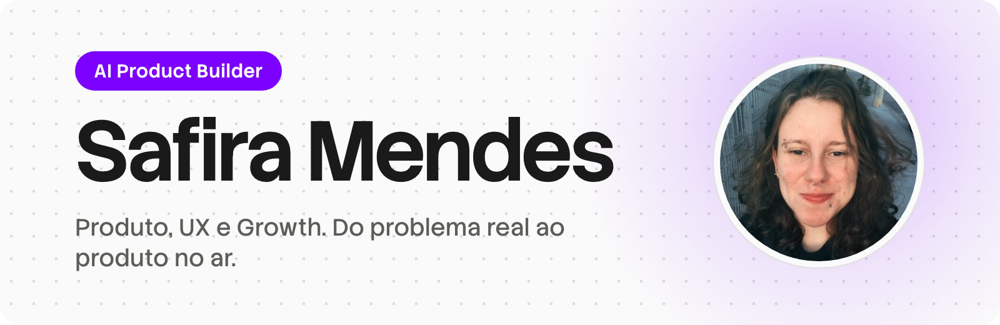
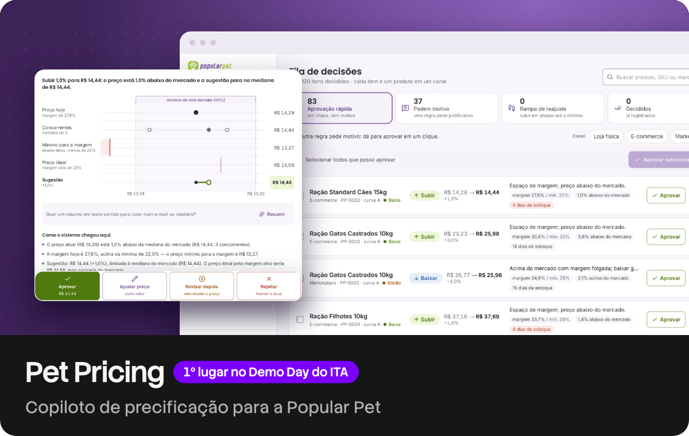
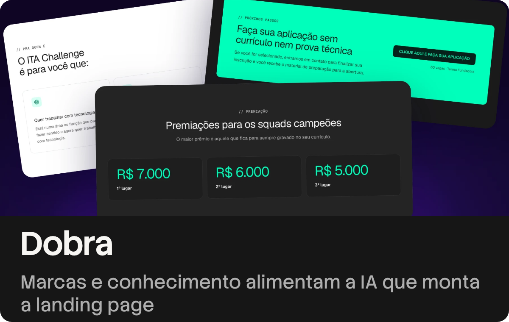
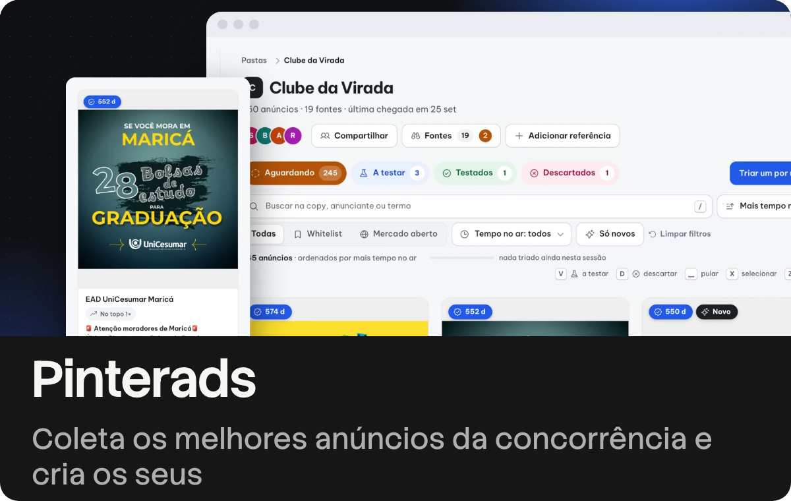
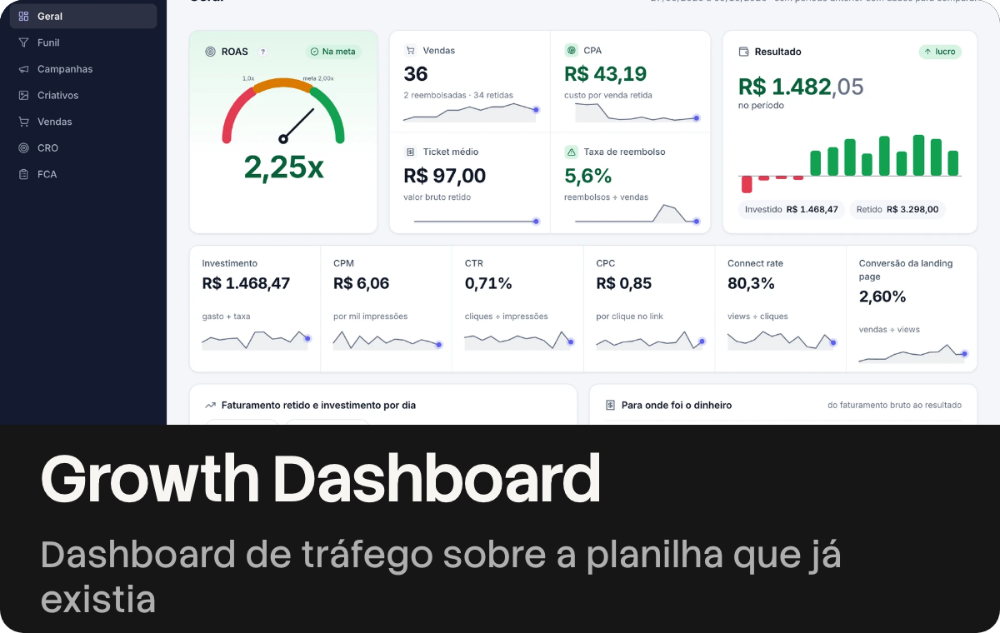

  <a href="https://safiramendes.com/?utm_source=github&utm_medium=profile&utm_campaign=readme">
    <picture>
      <source media="(prefers-color-scheme: dark)" srcset="assets/hero-dark.png">
      
    </picture>
  </a>

  
  
  

  Transformo uma dor real de uma área em um produto que funciona. 
  Converso com quem vive o problema, desenho a jornada e a interface, e construo com IA até estar rodando.

 

## Projetos

<table>
  <tr>
    <td colspan="2"></td>
  </tr>
  <tr>
    <td width="50%"></td>
    <td width="50%"></td>
  </tr>
  <tr>
    <td width="50%"></td>
    <td width="50%"></td>
  </tr>
</table>

Cada card abre o estudo de caso completo, com processo e decisões. Código aberto: <a href="https://github.com/safira-html/pet-pricing">pet-pricing</a> e <a href="https://github.com/safira-html/editor-videos">editor-videos</a>.

 

## Como eu trabalho

Descoberta e pesquisa, jornada e protótipo, construção com IA, automação e leitura de dados.
Fecho o ciclo com dados: defino a métrica, lanço, analiso o comportamento de quem usa, otimizo a conversão (CRO), aprendo e itero.
Em uma era em que gerar ficou barato, meu trabalho é trazer direção e cortar AI slop.

  
  
  
  
  
  
  
  

